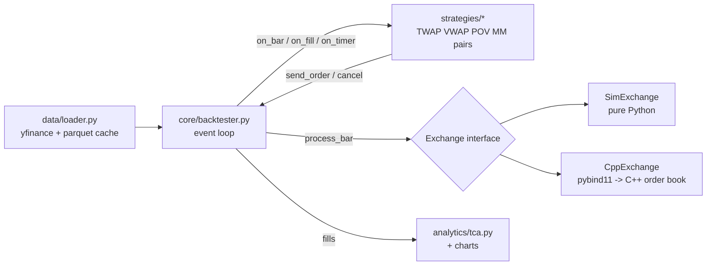

# algo-execution

A Python framework for executing large orders as a stream of small ones, the way a broker's
execution desk does. You give it a parent order ("buy 200,000 AAPL today") and an algo
(TWAP, VWAP or POV), and it slices the order across the day, backtests it on real minute
bars and grades the result with transaction cost analysis (TCA). It also runs a
market-making quoter and a pairs/spread strategy through the same strategy API.

The simulated exchange exists twice: once in plain Python and once as my
[C++20 limit order book](https://github.com/abhiroopyalavarthi/limit-order-book) called through
pybind11. A test checks that both give the same fills, share for share.

```
uv run algo compare --symbol AAPL --qty 200000 --date 2026-09-25
```

<!-- RESULTS_EXAMPLE -->

## Contents

- [How it's put together](#how-its-put-together)
- [The algos](#the-algos)
- [Fill model](#fill-model)
- [TCA](#tca)
- [Results](#results)
- [C++ exchange and speed](#c-exchange-and-speed)
- [Tests](#tests)
- [Running it](#running-it)
- [What I'd do next](#what-id-do-next)

## How it's put together



```
algo/
  core/orders.py        Order, Fill, Side, Bar (prices in integer ticks)
  core/strategy.py      Strategy base class + Context (the only API a strategy sees)
  core/backtester.py    event loop
  core/exchange.py      Exchange interface, fill model, SimExchange
  core/cpp_exchange.py  CppExchange, same interface on top of algo_cpp
  strategies/           twap, vwap, pov, baseline, market_maker, pairs
  data/loader.py        yfinance download, parquet cache, synthetic data
  analytics/            tca, charts, results batch runner, benchmark
  runner.py, cli.py
cpp/
  src/BarExchange.*     the fill model in C++, driving FastOrderBook
  src/bindings.cpp      pybind11 module algo_cpp
  extern/limit-order-book   git submodule
tests/                  pytest
notebooks/results.ipynb
```

Design rules I stuck to:

1. **Integer ticks at the exchange boundary.** Orders, fills and bars carry prices as integer
   cents, same as the order book. Floating point is fine in the analytics (averages, bps), but
   an exchange that compares prices with `==` can't have 0.1 + 0.2 != 0.3.
2. **No lookahead.** A strategy sees bar *t* only after the exchange has processed it, and
   anything it sends then trades in bar *t+1*. The VWAP volume curve for day D is built only
   from days before D, and there's a test that tampers with day D and later and checks the
   curve doesn't move.
3. **One exchange interface.** `send_order`, `cancel` and the fill callback are the only way
   strategies and exchanges talk. Swapping the Python exchange for the C++ one changes no
   strategy code.
4. **Deterministic.** The only randomness is in the synthetic data and in picking order sides
   for the batch run, and both are seeded. Same inputs, same fills.
5. **A fill model I can defend** (below), with its weaknesses written down.

## The algos

Every algo is a class with `on_start`, `on_bar`, `on_fill`, `on_timer` and `on_end` hooks.
TWAP, VWAP and POV share a parent-order base class (`strategies/base.py`) and only decide
*how much should be done by each bar*; the base class turns that into child market orders,
rounds them to 100-share lots, rolls missed shares into the next child and handles the
deadline.

| Algo | Follows | Notes |
|---|---|---|
| TWAP | the clock | 200,000 shares over 390 minutes is ~513/min. Lots are spread evenly; odd shares go in the last slice. |
| VWAP | historical volume curve | Average share of daily volume per minute over the previous 20 days, renormalised over the order's window. Behind schedule? The next child catches up. |
| POV | live volume | Sends `rate x last bar's volume` plus any shortfall. Each child carries `max_pov`, and the exchange clips it against the bar it actually trades in, so a sudden quiet bar can't push it over the max rate. |
| Aggressive | nothing | Worst-case baseline: asks for everything left, every bar. |
| Market maker | mid + inventory | Quotes around the bar's close, shifted down when long / up when short. Bids are sized so a full fill can't break the position limit. Flattens at the end. |
| Pairs | spread z-score | Daily bars. Rolling OLS beta of log A on log B, enter at \|z\| > 2, exit at \|z\| < 0.5, stop at \|z\| > 4. |

**Deadline rule.** With `on_deadline="sweep"` the last child asks for everything left
(TWAP and VWAP default); with `"report"` the algo never breaks its own pacing and the
unfilled shares show up in the TCA (POV default). Nothing is ever sent after the window.

## Fill model

All in `core/exchange.py`. Per bar, per symbol:

1. **Participation cap.** Our fills on each side are capped at 25% of the bar's volume.
2. **Resting limit orders** fill only if the bar trades *through* them (a buy at P needs
   low < P). Touching the price isn't enough because we don't know our queue position.
   Best price first, then oldest first.
3. **Market orders walk a synthetic book** built around the bar's typical price
   (H+L+C)/3: the first level is one tick away, each level holds 5% of the bar's volume.
   Buying 20% of a bar's volume walks four levels, so impact grows with order size relative
   to volume, and the same order costs more in a quiet bar than a busy one.
4. Whatever a market order can't fill in its bar is dropped (IOC).

Weaknesses, on purpose:

- **Impact is temporary and linear.** Our trades don't move the next bar's price. A real
  200k-share order leaves a footprint (permanent impact), so every algo here looks a bit
  better than it would live, and the aggressive baseline looks much better than it should.
- **Typical price isn't the price we'd have got.** Inside a minute we can't know whether
  we'd have traded near the high or the low.
- **Queue position is ignored**, hence the trade-through rule for limits, which makes the
  market maker's fill rate pessimistic.
- **Bar volume includes no one reacting to us.** 25% participation on a real tape would
  change the tape.

## TCA

`analytics/tca.py`, one report per parent order:

- **Arrival slippage**: average fill vs the first bar's open.
- **VWAP slippage**: average fill vs the market's VWAP over the same window.
- **Implementation shortfall**: arrival slippage on what filled, plus unfilled shares marked
  at the close.
- **Participation**: our shares / market shares over the window (and the max in any bar).
- **Tracking error**: RMS gap between our cumulative % done and the market's cumulative %
  of volume, bar by bar.

Everything is in basis points with the sign set so **positive = cost**: a buy that paid more
than the benchmark, or a sell that received less. `tests/test_tca.py` checks the numbers
against a 3-fill example worked out by hand.

## Results

<!-- RESULTS_TABLE -->

## C++ exchange and speed

<!-- BENCH -->

## Tests

`uv run pytest` (runs in CI on Ubuntu and macOS):

- an order that doesn't divide evenly fills every share and none extra
- POV never goes over its max rate, even when a bar's volume collapses
- an order that can't finish follows its deadline rule (sweep vs report)
- **lookahead**: the VWAP curve for day D doesn't change when day D and later are altered
- TCA matches a 3-fill hand calculation; buy/sell sign convention
- the market maker never goes past its max position; skew reduces average inventory
- same seed and inputs give identical fills
- SimExchange and CppExchange give identical fills for every algo and a hand-written
  sequence of limits, partial fills, cancels and market orders
- the baseline never exceeds the volume cap; limit orders need a trade-through; priority is
  price then time

## Running it

Needs Python 3.12, [uv](https://docs.astral.sh/uv/), and for the C++ exchange a C++20
compiler (Xcode command-line tools on a Mac).

```bash
git clone --recursive https://github.com/abhiroopyalavarthi/algo-execution.git
cd algo-execution
uv sync --extra cpp            # builds algo_cpp with CMake + scikit-build-core

uv run algo fetch              # cache ~29 days of minute bars (Yahoo only keeps ~30)
uv run algo run vwap --symbol AAPL --qty 200000 --date 2026-09-25 --chart vwap.png
uv run algo compare --symbol AAPL --qty 200000 --date 2026-09-25 --exchange cpp
uv run algo results            # batch run -> results/summary.md
uv run algo mm --symbol AAPL --chart mm.png
uv run algo pairs KO PEP --chart pairs.png
uv run algo bench

uv run algo compare --synthetic --symbol SYN   # no download needed
uv run pytest
```

Run `algo fetch` every week or two: cached days are kept, so the history grows past Yahoo's
30-day window. After changing C++ code: `uv sync --extra cpp --reinstall-package algo-cpp`.

## What I'd do next

- **Permanent impact.** Shift later bars' prices by some fraction of our cumulative
  imbalance, so fast algos pay for the footprint they leave.
- **Better volume forecasts.** Day-of-week and event-day adjustments (earnings, index
  rebalances, half days) for the VWAP curve, and blending in today's realised volume as the
  day goes on.
- **Limit-order child orders** for TWAP/VWAP (post passively, cross the spread only when
  behind schedule) and a queue-position model to go with them.
- **Tick data** instead of minute bars, which would make the C++ order book do real work.
- **Multi-leg spreads** as a strategy that owns several child algos. The Strategy API already
  handles several symbols (the pairs strategy uses it), so it wouldn't touch the exchange.
