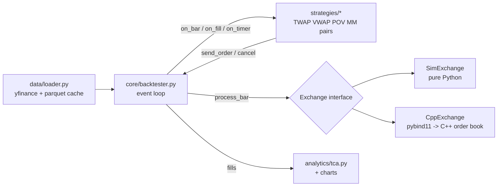
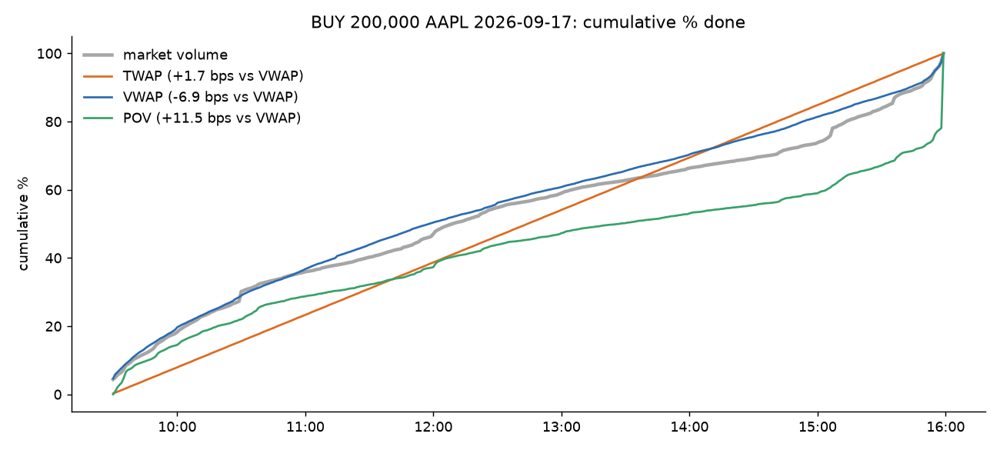
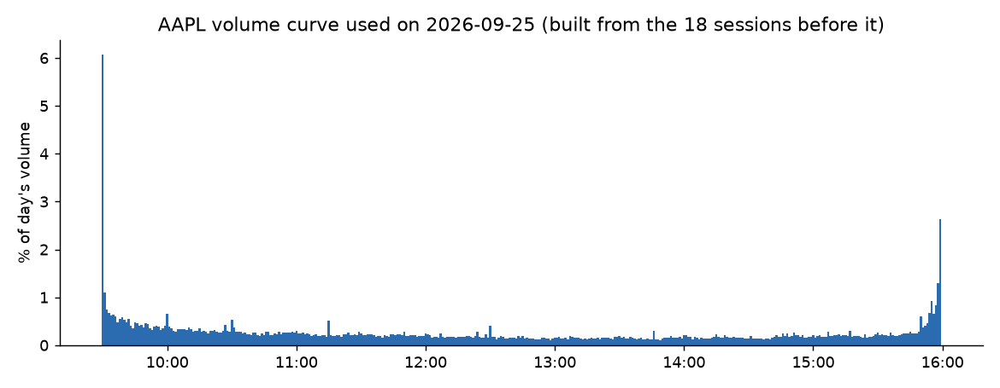
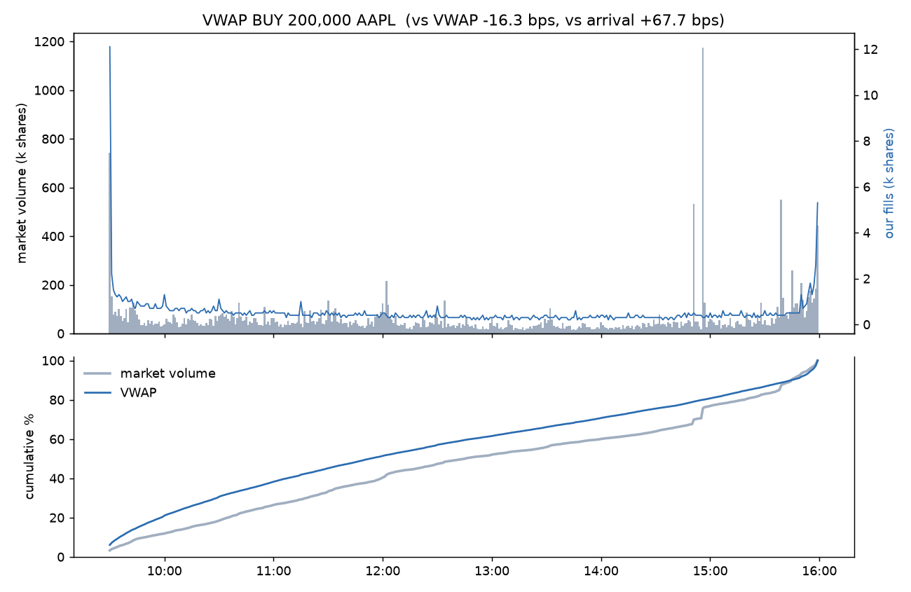
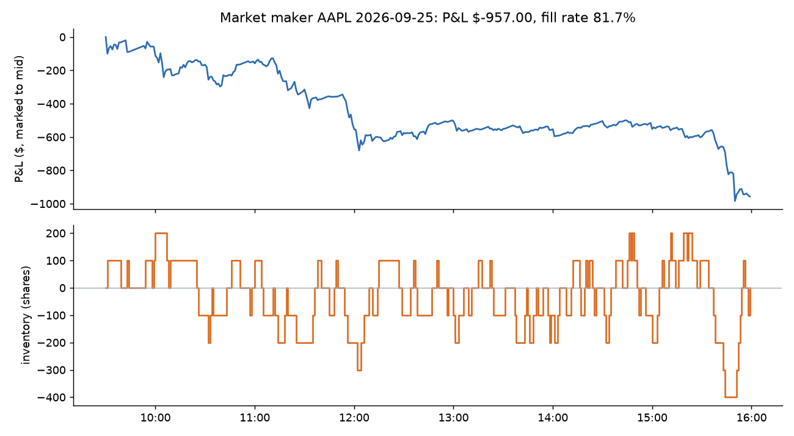
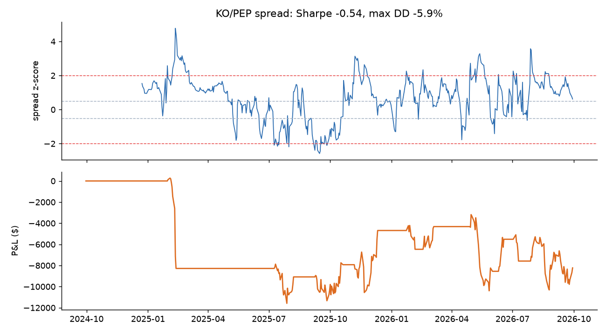

# algo-execution

A Python framework for executing large orders as a stream of small ones, the way a broker's
execution desk does. You give it a parent order ("buy 200,000 AAPL today") and an algo
(TWAP, VWAP or POV), and it slices the order across the day, backtests it on real minute
bars and grades the result with transaction cost analysis (TCA). It also runs a
market-making quoter and a pairs/spread strategy through the same strategy API.

The simulated exchange exists twice: once in plain Python and once as my
[C++20 limit order book](https://github.com/abhiroopyalavarthi/limit-order-book) called through
pybind11. A test checks that both give the same fills, share for share.

```
uv run algo compare --symbol AAPL --qty 200000 --date 2026-09-25
```

```
algo    vs arrival   vs VWAP   filled  tracking
twap       +82.99     -1.10   100.0%     6.58%
vwap       +67.71    -16.26   100.0%     9.65%
pov        +98.94    +14.71   100.0%    12.57%

closest to market VWAP: TWAP (-1.10 bps)
```

That particular day is one where VWAP *lost*, and the reason is below in [Results](#results).

## Contents

- [How it's put together](#how-its-put-together)
- [The algos](#the-algos)
- [Fill model](#fill-model)
- [TCA](#tca)
- [Results](#results)
- [C++ exchange and speed](#c-exchange-and-speed)
- [Trading through a FIX gateway](#trading-through-a-fix-gateway)
- [Tests](#tests)
- [Running it](#running-it)
- [What I'd do next](#what-id-do-next)

## How it's put together



```
algo/
  core/orders.py        Order, Fill, Side, Bar (prices in integer ticks)
  core/strategy.py      Strategy base class + Context (the only API a strategy sees)
  core/backtester.py    event loop
  core/exchange.py      Exchange interface, fill model, SimExchange
  core/cpp_exchange.py  CppExchange, same interface on top of algo_cpp
  strategies/           twap, vwap, pov, baseline, market_maker, pairs
  data/loader.py        yfinance download, parquet cache, synthetic data
  analytics/            tca, charts, results batch runner, benchmark
  runner.py, cli.py
cpp/
  src/BarExchange.*     the fill model in C++, driving FastOrderBook
  src/bindings.cpp      pybind11 module algo_cpp
  extern/limit-order-book   git submodule
tests/                  pytest
notebooks/results.ipynb
```

Design rules I stuck to:

1. **Integer ticks at the exchange boundary.** Orders, fills and bars carry prices as integer
   cents, same as the order book. Floating point is fine in the analytics (averages, bps), but
   an exchange that compares prices with `==` can't have 0.1 + 0.2 != 0.3.
2. **No lookahead.** A strategy sees bar *t* only after the exchange has processed it, and
   anything it sends then trades in bar *t+1*. The VWAP volume curve for day D is built only
   from days before D, and there's a test that tampers with day D and later and checks the
   curve doesn't move.
3. **One exchange interface.** `send_order`, `cancel` and the fill callback are the only way
   strategies and exchanges talk. Swapping the Python exchange for the C++ one changes no
   strategy code.
4. **Deterministic.** The only randomness is in the synthetic data and in picking order sides
   for the batch run, and both are seeded. Same inputs, same fills.
5. **A fill model I can defend** (below), with its weaknesses written down.

## The algos

Every algo is a class with `on_start`, `on_bar`, `on_fill`, `on_timer` and `on_end` hooks.
TWAP, VWAP and POV share a parent-order base class (`strategies/base.py`) and only decide
*how much should be done by each bar*; the base class turns that into child market orders,
rounds them to 100-share lots, rolls missed shares into the next child and handles the
deadline.

| Algo | Follows | Notes |
|---|---|---|
| TWAP | the clock | 200,000 shares over 390 minutes is ~513/min. Lots are spread evenly; odd shares go in the last slice. |
| VWAP | historical volume curve | Average share of daily volume per minute over the previous 20 days, renormalised over the order's window. Behind schedule? The next child catches up. |
| POV | live volume | Sends `rate x last bar's volume` plus any shortfall. Each child carries `max_pov`, and the exchange clips it against the bar it actually trades in, so a sudden quiet bar can't push it over the max rate. |
| Aggressive | nothing | Worst-case baseline: asks for everything left, every bar. |
| Market maker | mid + inventory | Quotes around the bar's close, shifted down when long / up when short. Bids are sized so a full fill can't break the position limit. Flattens at the end. |
| Pairs | spread z-score | Daily bars. Rolling OLS beta of log A on log B, enter at \|z\| > 2, exit at \|z\| < 0.5, stop at \|z\| > 4. |

**Deadline rule.** With `on_deadline="sweep"` the last child asks for everything left
(TWAP and VWAP default); with `"report"` the algo never breaks its own pacing and the
unfilled shares show up in the TCA (POV default). Nothing is ever sent after the window.

## Fill model

All in `core/exchange.py`. Per bar, per symbol:

1. **Participation cap.** Our fills on each side are capped at 25% of the bar's volume.
2. **Resting limit orders** fill only if the bar trades *through* them (a buy at P needs
   low < P). Touching the price isn't enough because we don't know our queue position.
   Best price first, then oldest first.
3. **Market orders walk a synthetic book** built around the bar's typical price
   (H+L+C)/3: the first level is one tick away, each level holds 5% of the bar's volume.
   Buying 20% of a bar's volume walks four levels, so impact grows with order size relative
   to volume, and the same order costs more in a quiet bar than a busy one.
4. Whatever a market order can't fill in its bar is dropped (IOC).

Weaknesses, on purpose:

- **Impact is temporary and linear.** Our trades don't move the next bar's price. A real
  200k-share order leaves a footprint (permanent impact), so every algo here looks a bit
  better than it would live, and the aggressive baseline looks much better than it should.
- **Typical price isn't the price we'd have got.** Inside a minute we can't know whether
  we'd have traded near the high or the low.
- **Queue position is ignored**, hence the trade-through rule for limits, which makes the
  market maker's fill rate pessimistic.
- **Bar volume includes no one reacting to us.** 25% participation on a real tape would
  change the tape.

## TCA

`analytics/tca.py`, one report per parent order:

- **Arrival slippage**: average fill vs the first bar's open.
- **VWAP slippage**: average fill vs the market's VWAP over the same window.
- **Implementation shortfall**: arrival slippage on what filled, plus unfilled shares marked
  at the close.
- **Participation**: our shares / market shares over the window (and the max in any bar).
- **Tracking error**: RMS gap between our cumulative % done and the market's cumulative %
  of volume, bar by bar.

Everything is in basis points with the sign set so **positive = cost**: a buy that paid more
than the benchmark, or a sell that received less. `tests/test_tca.py` checks the numbers
against a 3-fill example worked out by hand.

## Results

50 parent orders: AAPL, MSFT, NVDA, AMZN and JPM over the 10 sessions from 2026-09-15 to
2026-09-28, each sized at 1% of the symbol's average daily volume with a random side, and each
run with TWAP, VWAP and POV over the full day. Real 1-minute bars from Yahoo. Slippage in bps,
positive = cost. Produced by `uv run algo results`; raw rows in
[`results/results.csv`](results/results.csv).

| algo | orders | vs VWAP mean | vs VWAP \|mean\| | vs VWAP std | vs arrival mean | tracking err % | fill rate % |
|:--|--:|--:|--:|--:|--:|--:|--:|
| TWAP | 50 | -0.87 | 10.24 | 15.70 | 5.35 | 11.76 | 100.00 |
| VWAP | 50 | 0.20 | **6.61** | **9.91** | 6.45 | **5.41** | 100.00 |
| POV | 50 | -2.08 | 11.76 | 17.89 | 4.19 | 13.34 | 99.98 |

**VWAP finished closer to the market's VWAP than TWAP on 35 of 50 orders**, and cut the
average absolute slippage vs VWAP from 10.24 to 6.61 bps (35% lower) with a spread about a third
smaller. All three average near zero *signed* slippage vs VWAP, which is expected: over many
orders a schedule doesn't beat the market's average price, it just tracks it more or less
tightly. The absolute number and the std are what separate them.

Arrival slippage is similar for all three (5-6 bps) because it's mostly the day's drift, not
the algo: all three spread the order over the whole day, so they all pay for whatever the stock
did between 09:30 and 16:00.



**Why VWAP usually wins, and the day it didn't.** Intraday volume is U-shaped: the first
and last 30 minutes of AAPL's day carried 20% and 13% of the volume on average, versus 10% for
the whole hour around lunch.



TWAP ignores that, so it's under-weight at the open and close and over-weight at lunch, and its
average price drifts away from the market's volume-weighted one. VWAP follows the historical
curve. But it's a forecast: on 2026-09-25 AAPL traded 530k shares at 14:51, 1.18M at 14:56 (more than
the opening minute) and more heavy minutes into the close, so the day's volume was back-loaded compared with the previous weeks. VWAP was
ahead of the market all day (tracking error 9.7% vs TWAP's 6.6%) and ended 16 bps from the
market's VWAP while TWAP ended 1 bp away.



POV has the worst tracking even though it follows live volume, because it can only react to the
*previous* minute's volume and its pace is set from the average day. On a busy day it finishes
early and on a quiet day it has to catch up at the end.

A caveat on history: Yahoo only serves the last ~30 days of minute bars, so these curves are built
from the 10-19 sessions before each test day rather than a full 20. Re-running `algo fetch`
every week or two grows the cache.

**Market maker** (AAPL, 2026-09-25, quoting 100 shares 2 cents either side of the last close,
max position 1,000): traded 63,400 shares with an 82% fill rate, inventory never past 400 shares,
flat at the close, **P&L -$957**. It loses because of the fill model: a quote only fills if
the next bar trades *through* it, so every fill is one where the price kept going the wrong way
(adverse selection) and the 2-cent edge doesn't cover it. That's also roughly why real market
makers care so much about queue position and spread width.



**Pairs** (KO/PEP, daily bars 2024-09-30 to 2026-09-29, 60-day rolling beta, $100k a leg):
21 trades, **Sharpe -0.54, max drawdown -5.9%**. Most of the loss is one trade in
February 2025, when the spread went from 2 to almost 5 standard deviations and hit the stop:
the textbook failure mode where the relationship breaks and doesn't come back. After that it
roughly breaks even. I left it as it is instead of tuning thresholds until the backtest looked
good.



## C++ exchange and speed

`CppExchange` has the same interface as `SimExchange`, but matching happens in my order book
(`FastOrderBook`) through pybind11. `cpp/src/BarExchange.cpp` implements the fill model *with*
the book: our resting limits are real orders in it, the bar's trade-through is a synthetic IOC
order that sweeps them with normal price-time priority, and a market order walks a real ladder of
synthetic resting orders. The batch results above were run on both exchanges and the CSVs are
identical ([`results/cpp/`](results/cpp)), and `tests/test_cpp_exchange.py` checks every algo
fill by fill.

`uv run algo bench` on an M2 MacBook Pro (macOS, Python 3.12,
[`results/bench_mac.md`](results/bench_mac.md)):

| | Python exchange | C++ exchange | C++ / Python |
|---|--:|--:|--:|
| End to end: TWAP + VWAP + market maker, 20 days | 64,038 bars/s | 69,501 bars/s | 1.09x |
| Exchange only: ~90 orders/bar, deep book | 443,547 orders/s | 721,183 orders/s | 1.63x |

So the C++ exchange **doesn't make whole backtests meaningfully faster**. On minute bars the
matching work per bar is tiny (a strategy sends one or two orders a minute), and the time goes
to the Python side: the event loop, the strategies, creating `Order` and `Fill` objects, and
the pybind11 call itself (argument conversion and building the return list cost more than the
match). That's why `BarExchange.process_bar` handles a whole bar per call instead of exposing one
call per match. The C++ side only pulls ahead when the book has real work to do, and even then
by 1.63x, because every order still starts life as a Python object.

Using the book this way also turned up a bug in it. When one side of `FastOrderBook` emptied,
it walked the whole price band looking for the next best price, and the backtester empties a
side every bar, so the first version of the C++ exchange was *slower* than Python (0.77x end to
end the first time I measured it). The fix, a count of non-empty levels per side, is in the order book repo
([`d4d95a1`](https://github.com/abhiroopyalavarthi/limit-order-book/commit/d4d95a1)).

## Trading through a FIX gateway

`FixExchange` (`core/fix_exchange.py`) is a third implementation of the same exchange interface.
It sends orders over FIX 4.4 to my [C++ FIX gateway](https://github.com/abhiroopyalavarthi/fix-gateway),
which runs risk checks and matches them in the same order book. It uses two FIX sessions:

- `ALGO` carries the strategy's child orders.
- `LP` replays each bar into the gateway's book, following the fill model above: an IOC that
  sweeps our resting limits if the bar traded through them, a ladder of resting orders around the
  typical price for our market orders to walk, then cancels for whatever is left of the ladder.

Each step waits for its execution reports before the next, because the two sessions are separate
TCP connections and the gateway could otherwise see them out of order. With that, a backtest over
FIX gives the same fills as the simulator:

```
$ uv run algo fixcheck vwap --symbol AAPL --qty 200000 --date 2026-09-25
VWAP buy 200,000 AAPL 2026-09-25
  SimExchange:    390 fills, avg 338.3153, -16.26 bps vs VWAP
  FixExchange:    390 fills, avg 338.3153, -16.26 bps vs VWAP  (3.3 s through the gateway)
  identical fills, share for share
```

TWAP, POV and the market maker match too (`tests/test_fix_exchange.py`, which runs when a gateway
is up). The strategy code doesn't change at all; `--exchange fix` works on `algo run` and
`algo compare` as well.

## Tests

`uv run pytest` (runs in CI on Ubuntu and macOS):

- an order that doesn't divide evenly fills every share and none extra
- POV never goes over its max rate, even when a bar's volume collapses
- an order that can't finish follows its deadline rule (sweep vs report)
- **lookahead**: the VWAP curve for day D doesn't change when day D and later are altered
- TCA matches a 3-fill hand calculation; buy/sell sign convention
- the market maker never goes past its max position; skew reduces average inventory
- same seed and inputs give identical fills
- SimExchange and CppExchange give identical fills for every algo and a hand-written
  sequence of limits, partial fills, cancels and market orders
- the baseline never exceeds the volume cap; limit orders need a trade-through; priority is
  price then time

## Running it

Needs Python 3.12, [uv](https://docs.astral.sh/uv/), and for the C++ exchange a C++20
compiler (Xcode command-line tools on a Mac).

```bash
git clone --recursive https://github.com/abhiroopyalavarthi/algo-execution.git
cd algo-execution
uv sync --extra cpp            # builds algo_cpp with CMake + scikit-build-core

uv run algo fetch              # cache ~29 days of minute bars (Yahoo only keeps ~30)
uv run algo run vwap --symbol AAPL --qty 200000 --date 2026-09-25 --chart vwap.png
uv run algo compare --symbol AAPL --qty 200000 --date 2026-09-25 --exchange cpp
uv run algo results            # batch run -> results/summary.md
uv run algo mm --symbol AAPL --chart mm.png
uv run algo pairs KO PEP --chart pairs.png
uv run algo bench

uv run algo compare --synthetic --symbol SYN   # no download needed

# through the FIX gateway (start ../fix-gateway/build/fix_gateway first)
uv sync --extra cpp --extra fix   # the quickfix package compiles from source, a few minutes
uv run algo fixcheck vwap --symbol AAPL --qty 200000 --date 2026-09-25
uv run pytest
```

Run `algo fetch` every week or two: cached days are kept, so the history grows past Yahoo's
30-day window. After changing C++ code: `uv sync --extra cpp --reinstall-package algo-cpp`.

## What I'd do next

- **Permanent impact.** Shift later bars' prices by some fraction of our cumulative
  imbalance, so fast algos pay for the footprint they leave.
- **Better volume forecasts.** Day-of-week and event-day adjustments (earnings, index
  rebalances, half days) for the VWAP curve, and blending in today's realised volume as the
  day goes on.
- **Limit-order child orders** for TWAP/VWAP (post passively, cross the spread only when
  behind schedule) and a queue-position model to go with them.
- **Tick data** instead of minute bars, which would make the C++ order book do real work.
- **Multi-leg spreads** as a strategy that owns several child algos. The Strategy API already
  handles several symbols (the pairs strategy uses it), so it wouldn't touch the exchange.
